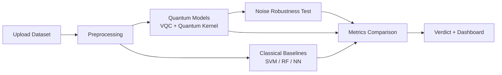

<div align="center">

# Quantum Coders

**VTU-QFF-HC-0092** &nbsp;|&nbsp; Tier: **Online**

</div>

---

<div align="center">

| | |
| :--- | :--- |
| **Team** | Quantum Coders |
| **Team ID** | VTU-QFF-HC-0092 |
| **Tier** | Online |
| **Repository** | [vtu-hc-quantum-coders-0092](https://github.com/vtu-qiskit-fall-fest-2026/vtu-hc-quantum-coders-0092.git) |
| **Organisation** | [vtu-qiskit-fall-fest-2026](https://github.com/vtu-qiskit-fall-fest-2026) |
| **Event** | VTU-QFF Hackathon — VTU-Qiskit Fall Fest 2026 |

</div>

---

## 📌 Table of Contents

- [Team Members](#-team-members-github-ids)
- [Problem Statement](#-problem-statement)
- [Proposed Solution](#-proposed-solution)
- [Approach & Architecture](#-approach--architecture)
- [Tech Stack](#-tech-stack)
- [Project Structure](#-project-structure)
- [How to Run](#-how-to-run)
- [How to Push Code](#-how-to-push-code)
- [Submission Checklist](#-submission-checklist)
- [Resources](#-resources)
- [License](#-license)

---

## 👥 Team Members (GitHub IDs)

> Members are added to this repository as **collaborators** and must accept the
> GitHub invitation before they can push.

| # | Name | GitHub Username | Role |
| :-- | :--- | :--- | :--- |
| 1 | Sugappriyan | SUGAN-2007 | Team Lead |
| 2 | Udhaya Prakash | Udhaya-prakash007 | Developer |
| 3 | Shakthi Bharathi D T | Tomcruise2711 | Developer |

---

## ❓ Problem Statement

**Problem:** Quantum machine learning (QML) is often claimed to outperform classical ML, but developers have no easy, fair way to test whether quantum actually helps on their own data. Most QML demos show a quantum model in isolation, with no classical baseline and no consideration of real hardware noise, so the claims are hard to trust.

**Why it matters:** Without honest, reproducible evaluation, teams either dismiss QML or adopt it on hype. A simple benchmarking tool helps developers decide when quantum is worth using, and when a classical model is the better choice.

**Track / Category:** Online · Quantum + AI & ML

---

## 💡 Proposed Solution

**Solution:** A web platform where a user uploads a small tabular dataset (or picks a sample one). The system trains quantum models (variational quantum classifier and quantum kernel SVM, run on Qiskit simulators) alongside classical baselines (SVM, random forest, small neural network) and compares them on accuracy, training time, parameter count, and robustness under simulated hardware noise. It then produces a plain-language verdict on whether quantum is worth using for that dataset.

**Key idea:** A fair, noise-aware, side-by-side QML vs classical ML benchmark with an honest verdict report.

**Why this works:** It replaces hype with evidence. Every quantum model is judged against strong classical baselines on the same data and the same train/test split, and its accuracy is re-tested under realistic noise, so users see what would survive on near-term hardware.

---

## 🧩 Approach & Architecture



1. **Input** — a small tabular CSV (features + label), or a built-in sample dataset
2. **Preprocessing** — cleaning, scaling, feature reduction to a qubit-friendly size, fixed train/test split shared by all models
3. **Quantum core** — Variational Quantum Classifier (feature map + ansatz, trained with COBYLA/SPSA) and a quantum-kernel SVM, run on Qiskit Aer
4. **Classical baselines + noise test** — SVM, random forest and a small neural network on the same split; the quantum models are re-evaluated under Aer noise models at increasing noise levels
5. **Output** — a dashboard with side-by-side accuracy, training time, parameter count and a noise-vs-accuracy curve, plus a plain-language verdict ("quantum helps / doesn't help, and why")

---

## 🛠️ Tech Stack

| Layer | Technology |
| :--- | :--- |
| Language | Python 3.11+ |
| Quantum SDK | Qiskit `>=1.0`, Qiskit Aer, Qiskit Machine Learning |
| Optimisation | COBYLA / SPSA |
| Simulation | AerSimulator (statevector / noise model) |
| Classical ML | scikit-learn |
| Backend API | FastAPI |
| Frontend | React dashboard with charts |
| Environment | JupyterLab / VS Code, `venv` |
| Version control | Git + GitHub |

---

## 📁 Project Structure

```text
vtu-hc-quantum-coders-0092/
├── README.md              # This file
├── requirements.txt       # Python dependencies
├── .gitignore
├── notebooks/             # Jupyter notebooks for experiments
│   └── exploration.ipynb
├── src/
│   ├── __init__.py
│   ├── data.py            # Loading, preprocessing, splitting
│   ├── classical.py       # Classical baseline models
│   ├── quantum.py         # VQC and quantum-kernel models
│   ├── noise.py           # Noise models and robustness sweep
│   ├── verdict.py         # Metrics comparison and verdict logic
│   ├── api.py             # FastAPI endpoints
│   └── main.py            # Entry point
├── frontend/              # React dashboard
├── data/                  # Sample datasets (use Git LFS for large files)
├── tests/                 # Unit tests
└── docs/                  # Notes, diagrams, reports
```

---

## 🚀 How to Run

### Prerequisites

- Python 3.11 or newer
- [Git](https://git-scm.com/downloads)
- A GitHub account (you need collaborator access to this repo)

### 1. Clone the repository

```bash
git clone https://github.com/vtu-qiskit-fall-fest-2026/vtu-hc-quantum-coders-0092.git
cd vtu-hc-quantum-coders-0092
```

### 2. Create a virtual environment

```bash
python3 -m venv .venv
source .venv/bin/activate        # Linux / macOS
# .venv\Scripts\activate         # Windows (PowerShell)
```

### 3. Install dependencies

```bash
pip install --upgrade pip
pip install -r requirements.txt
```

### 4. Run

```bash
python -m src.main
```

Or launch the notebook workflow:

```bash
jupyter lab
```

### 5. Run the tests

```bash
pytest -q
```

---

## 🔁 How to Push Code

> Full walkthrough: **[Git & Collaboration Handbook](../vtu-hc-guide-git-and-collaboration)** — collaboration
> workflow, branches, pull requests, reviews and conflict resolution.

### Configure Git (first time only)

```bash
git config --global user.name  "Your Name"
git config --global user.email "you@example.com"
```

### Everyday workflow

```bash
# 1. Get the latest changes
git checkout main
git pull origin main

# 2. Create a branch for your work
git checkout -b feature/my-task

# 3. Commit your work
git add .
git commit -m "feat: add variational quantum classifier"

# 4. Push the branch
git push -u origin feature/my-task

# 5. Open a Pull Request on GitHub and request a review
#    https://github.com/vtu-qiskit-fall-fest-2026/vtu-hc-quantum-coders-0092/compare/main...feature/my-task

# 6. After approval, merge into main
git checkout main
git pull origin main
git branch -d feature/my-task
```

### Commit message convention

| Prefix | Meaning |
| :--- | :--- |
| `feat:` | New feature |
| `fix:` | Bug fix |
| `docs:` | Documentation only |
| `test:` | Adding or fixing tests |
| `refactor:` | Code restructure, no behaviour change |
| `chore:` | Build/config/dependency changes |

### Useful commands

```bash
git status              # what changed
git log --oneline -10   # recent commits
git diff                # review changes before committing
git stash               # shelve changes temporarily
git pull --rebase       # update your branch on top of main
```

### Collaborating on the same repo

- **Never push directly to `main`** — open a Pull Request.
- **Pull before you push** to avoid rejected commits.
- **Commit often** with clear messages.
- **Resolve conflicts** locally: `git pull --rebase`, fix the files, then `git add` + `git rebase --continue`.
- **Ask for a review** before merging — a second pair of eyes catches bugs fast.

---

## ✅ Submission Checklist

- [ ] Repository created and **public**
- [ ] All team members added as **collaborators** and invitations accepted
- [x] `README.md` updated with project details, problem statement and solution
- [x] Team members listed under [Team Members](#-team-members-github-ids)
- [ ] `requirements.txt` committed and project runs from a clean clone
- [ ] Code pushed to `main` and the latest `main` builds successfully
- [ ] Notebooks committed with **cleared outputs** (or use `nbstrip`)
- [ ] `README` includes a demo screenshot / video link
- [ ] Short project summary submitted on the hackathon portal

---

## 📚 Resources

| Resource | Link |
| :--- | :--- |
| 🔁 Git & collaboration handbook | [Git & Collaboration Handbook](../vtu-hc-guide-git-and-collaboration) |
| ❓ Problem statements, solutions & terms | [Problem Statements, Solutions & Terms](../vtu-hc-guide-problem-and-solution) |
| 📄 README writing guide | [README Guide & Template](../vtu-hc-guide-readme-template) |
| ⚛️ Qiskit documentation | https://docs.quantum.ibm.com/ |
| ⚛️ Qiskit Runtime & primitives | https://quantum.cloud.ibm.com/docs/ |
| 🧪 Qiskit Aer simulator | https://docs.quantum.ibm.com/guides/simulator |
| 💻 IBM Quantum Platform | https://quantum.cloud.ibm.com/ |
| 🎓 Qiskit textbook | https://qiskit.qotlabs.org/learning/ |
| 📋 GitHub Docs | https://docs.github.com/ |

---

## 📄 License

Released under the [MIT License](LICENSE). See `LICENSE` for details.

---

<div align="center">

**Quantum Coders** · Team ID `VTU-QFF-HC-0092` · Tier `Online`
· Built with ⚛️ Qiskit for the VTU-QFF Hackathon

[⬆ Back to Top](#quantum-coders)

</div>
